# 🛒 Fruver POS Frontend SPA & PWA

[](https://react.dev/)
[](https://vitejs.dev/)
[](https://tailwindcss.com/)
[]()
[]()
[](LICENSE)

Interfaz de usuario moderna, rápida y ultra-responsiva para el sistema **Fruver POS**, construida con **React 19**, **Vite** y **Tailwind CSS v4**. Diseñada específicamente para puntos de venta comerciales, minimercados y fruvers, ofreciendo soporte para pantallas táctiles, escáneres ópticos de códigos de barra, modo quiosco y compatibilidad PWA con funcionamiento offline.

---

## 📸 Demostración Visual de la Interfaz

Explora los módulos funcionales del frontend en vivo:

### 1. Acceso y Temas (Modo Oscuro / Claro)
| 🌙 Interfaz en Modo Oscuro | ☀️ Interfaz en Modo Claro |
| :---: | :---: |
| 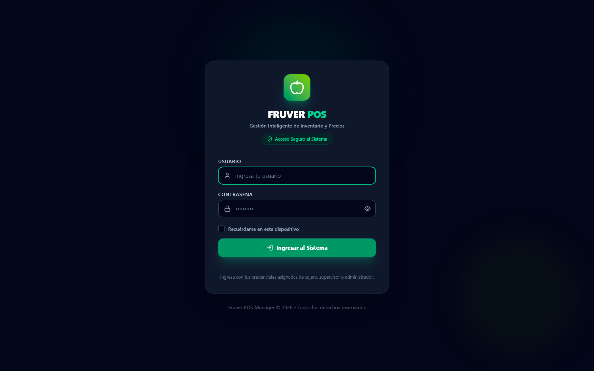 | 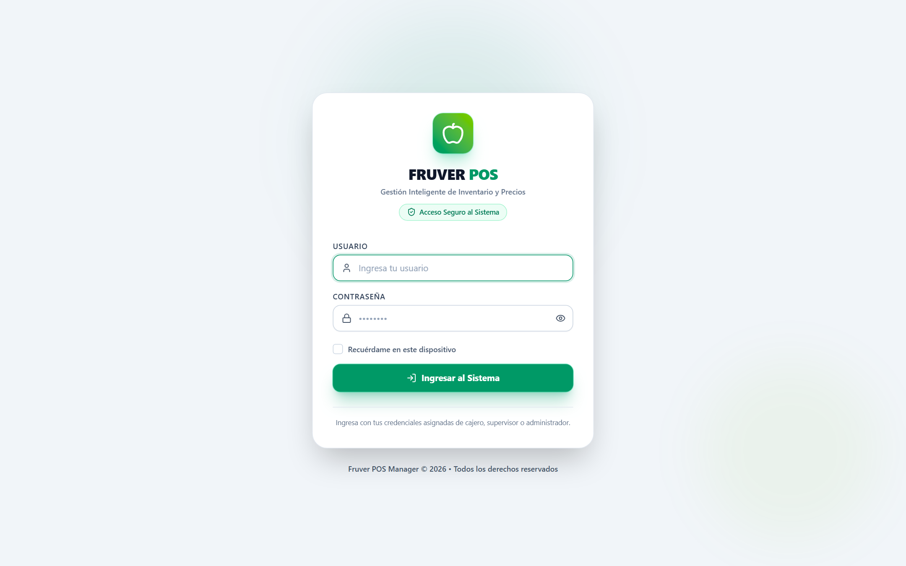 |
| *Acceso seguro con autenticación JWT y diseño adaptativo* | *Paleta de contraste optimizada para alta luminosidad* |

---

### 2. Terminal POS & Catálogo Maestro
| 🔍 Terminal de Consulta & Escáner POS | 📦 Catálogo Maestro de Productos |
| :---: | :---: |
| 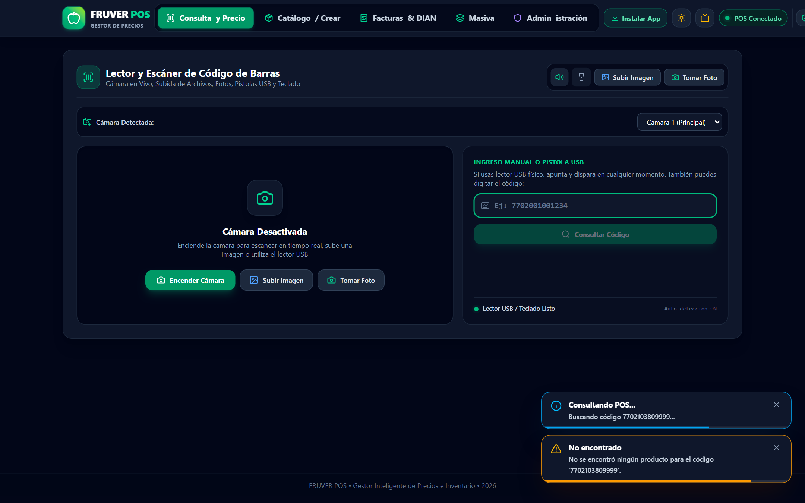 | 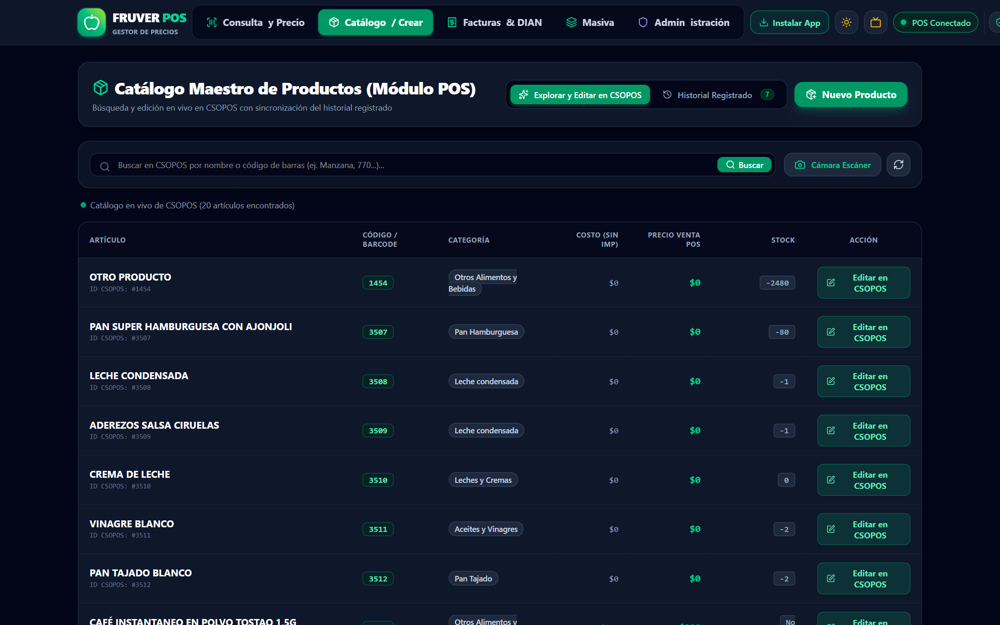 |
| *Búsqueda omnidireccional y lector de barras con cámara/USB* | *Control visual de stock, filtros rápidos y badges de estado* |

---

### 3. Editor de Precios & Redondeo Comercial ($100 COP)
| 🏷️ Editor Individual & Cálculo de Margen | ⚡ Edición Masiva de Precios por Lote |
| :---: | :---: |
| 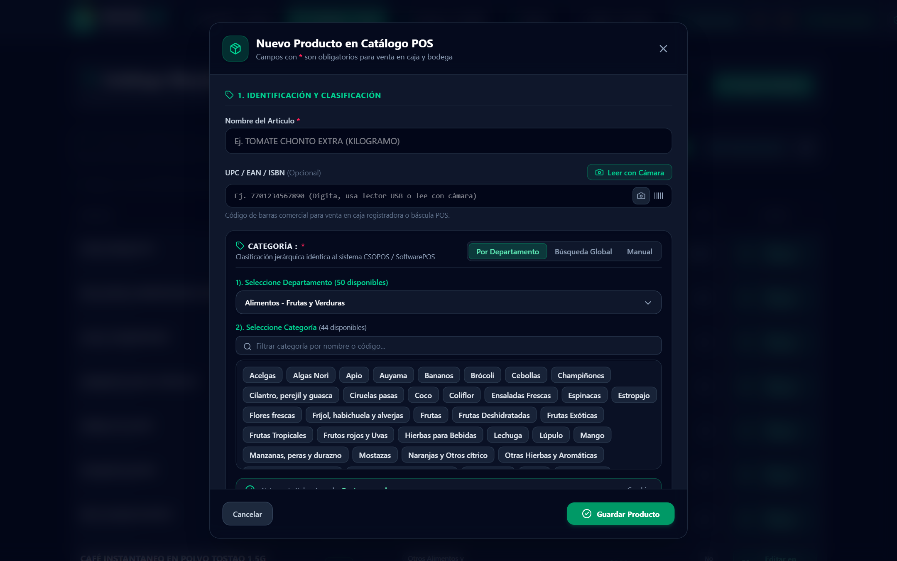 | 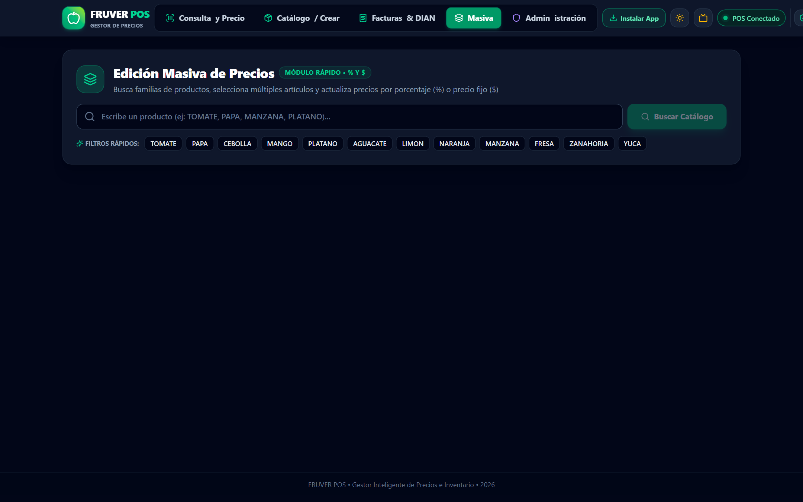 |
| *Cálculo en vivo de costos, IVA, fletes y regla a centenas* | *Actualización por lote o categoría con vista previa inmediata* |

---

### 4. Facturación Electrónica DIAN & Asistente QR
| 🧾 Procesador y Liquidación de Facturas | 📱 Asistente DIAN VPFE & Extractor QR |
| :---: | :---: |
| 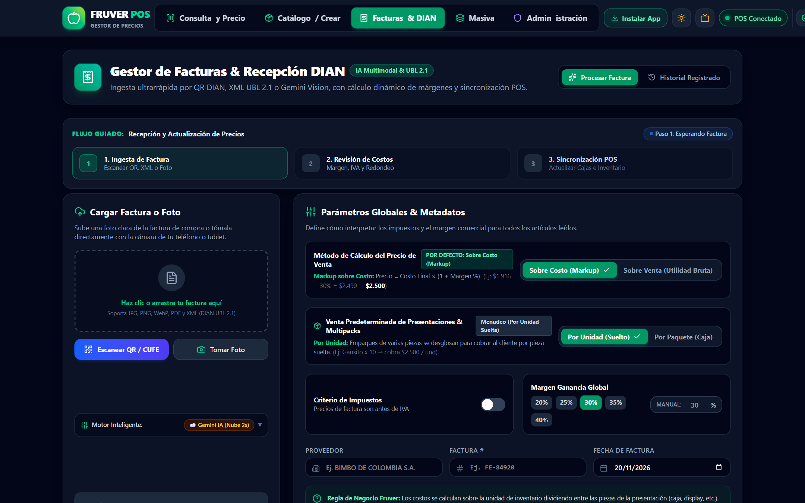 | 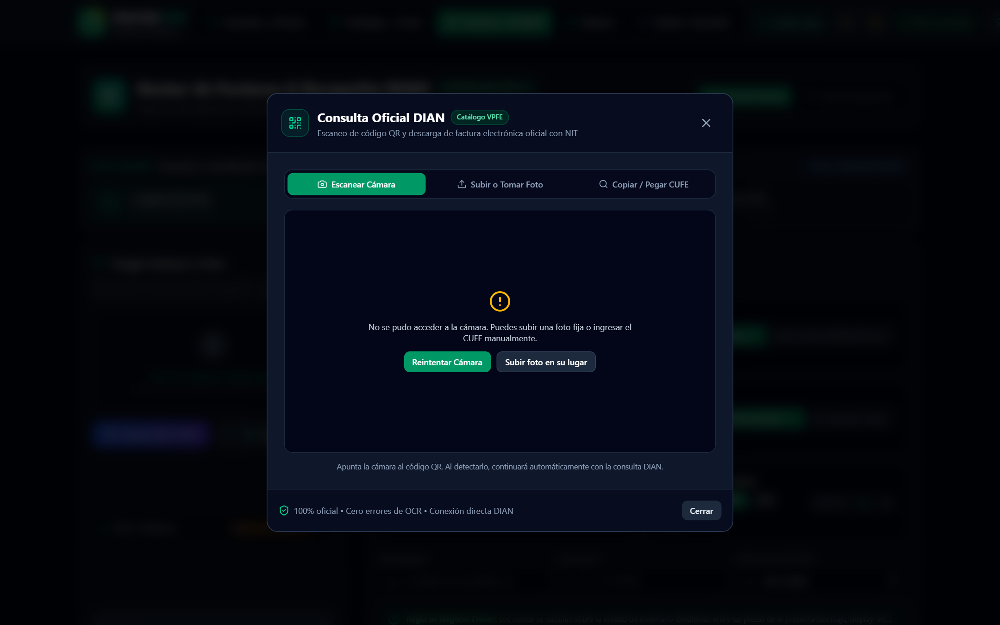 |
| *Liquidación de compras con prorrateo de flete por kilo* | *Captura directa de QR DIAN y visualizador estructurado* |

---

### 5. Control Administrativo & Modo PWA Móvil
| 🛡️ Panel Administrativo & Roles RBAC | 📲 Experiencia Móvil PWA (Bodega / Táctil) |
| :---: | :---: |
| 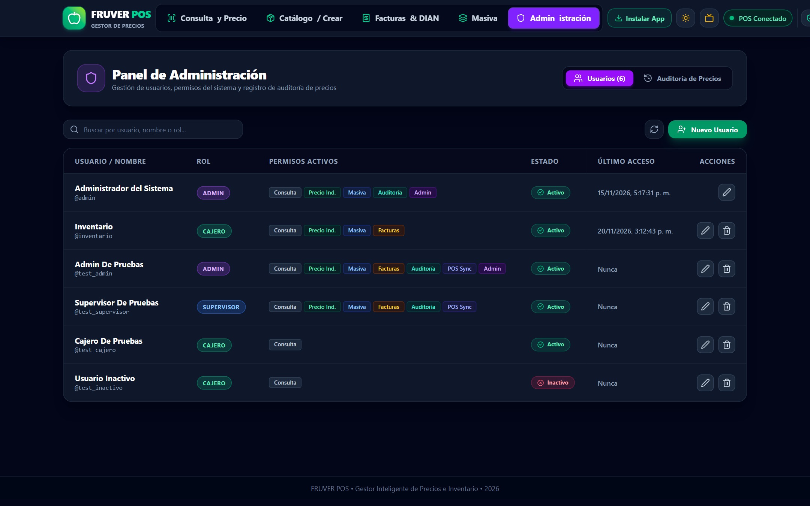 | 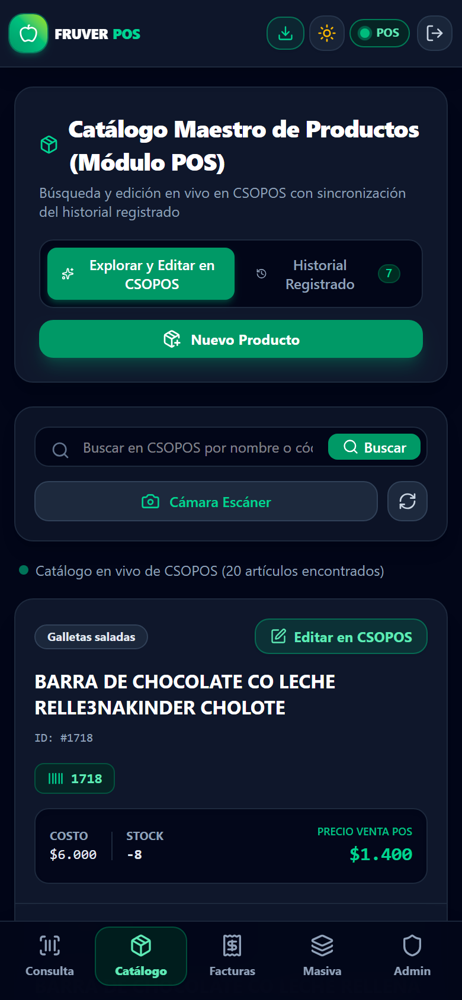 |
| *Gestión de usuarios y permisos diferenciados por rol* | *PWA instalable a pantalla completa con soporte offline* |

---

## 🏗️ Arquitectura de Componentes & Estado

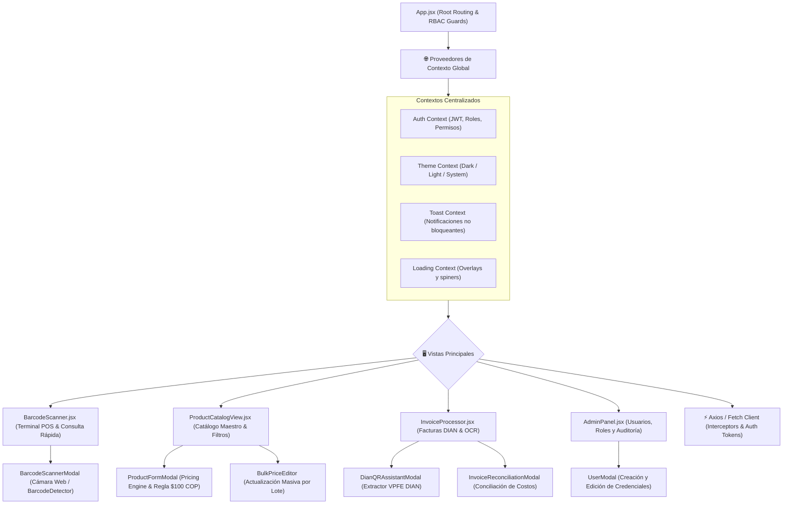

---

## 📱 Ciclo de Vida PWA & Soporte Offline

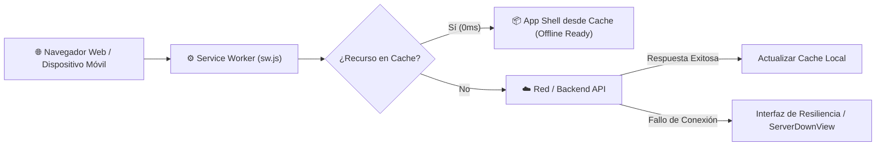

---

## 🌟 Características Clave

- **Búsqueda Omnidireccional & Escaneo en Tiempo Real**:
  - Detección nativa con `BarcodeDetector API` del navegador.
  - Fallback automático a `ZXing WebAssembly` para dispositivos antiguos o navegadores sin soporte nativo.
  - Búsqueda instantánea por nombre, código interno, PLU o código de barras.

- **Regla Comercial de Redondeo a Centenas ($100 COP)**:
  - Integrada en todos los modales de edición de precios.
  - Si el residuo es `>= $50 COP`, redondea hacia arriba (`$3.560` ➔ `$3.600`).
  - Si el residuo es `< $50 COP`, redondea hacia abajo (`$3.540` ➔ `$3.500`).

- **Temas Adaptativos**:
  - Selector de Modo Oscuro, Modo Claro y Sincronización con el Sistema Operativo con persistencia en `localStorage`.

- **PWA de Cero Latencia**:
  - Instalable en smartphones, tablets de bodega o computadores de escritorio con un solo clic.
  - Ejecución en pantalla completa (Modo Quiosco).

---

## 📁 Estructura del Repositorio

```text
fruver-pos-frontend/
├── public/                         # Iconos PWA, manifest.json y sw.js (Service Worker)
├── src/
│   ├── components/
│   │   ├── Admin/                  # Panel administrativo y modal de usuarios
│   │   ├── Auth/                   # Login seguro con validación de credenciales
│   │   ├── Catalog/                # Vista de catálogo y modal de ficha de producto
│   │   ├── Invoices/               # Procesador de facturas, asistente QR y conciliación
│   │   ├── common/                 # Modales reutilizables, escáner, toasts y error boundary
│   │   ├── BarcodeScanner.jsx      # Terminal POS de escaneo y consulta rápida
│   │   ├── BulkPriceEditor.jsx     # Editor masivo de precios
│   │   ├── Navbar.jsx              # Barra de navegación adaptable con selector de temas
│   │   ├── ProductCard.jsx         # Tarjeta de producto con precios y stock
│   │   └── SinglePriceModal.jsx    # Editor rápido de precio individual
│   ├── context/                    # Contextos globales de autenticación, tema y toasts
│   ├── services/                   # Cliente API REST y llamadas a endpoints
│   ├── utils/                      # Formateadores de moneda COP, escáner y compresión
│   ├── App.jsx                     # Enrutador principal y validación de roles RBAC
│   ├── index.css                   # Tokens de diseño y estilos Tailwind CSS v4
│   └── main.jsx                    # Punto de entrada React 19
├── docs/screenshots/               # Capturas visuales de alta resolución
├── .env.example                    # Plantilla de variables de entorno
├── .gitignore                      # Exclusiones de Git para proyectos Node.js
├── .oxlintrc.json                  # Reglas del linter de código Oxlint
├── index.html                      # Documento HTML principal
├── package.json                    # Dependencias y scripts de compilación
├── vite.config.js                  # Configuración de Vite y proxy inverso
├── LICENSE                         # Licencia abierta MIT
└── README.md                       # Documentación principal
```

---

## 🚀 Instalación y Puesta en Marcha

### Prerrequisitos
- **Node.js** 18 o superior.
- **npm** o **pnpm**.

### 1. Clonar el Repositorio
```bash
git clone https://github.com/tu-usuario/fruver-pos-frontend.git
cd fruver-pos-frontend
```

### 2. Instalar Dependencias
```bash
npm install
```

### 3. Configurar Variables de Entorno
```bash
# En Windows:
copy .env.example .env

# En Linux / macOS:
cp .env.example .env
```

Contenido de `.env`:
```env
# URL base de la API Backend (FastAPI)
VITE_API_URL=http://localhost:8000
```

### 4. Iniciar en Modo Desarrollo
```bash
npm run dev
```
Abre en tu navegador: [http://localhost:5173](http://localhost:5173)

---

## 🛠️ Scripts Disponibles

```bash
# Iniciar servidor de desarrollo con recarga rápida (HMR)
npm run dev

# Compilar para producción (optimizado y minificado)
npm run build

# Previsualizar el compilado de producción localmente
npm run preview

# Ejecutar el linter estricto de código
npm run lint
```

---

## 📄 Licencia
Este proyecto está bajo la Licencia abierta [MIT](LICENSE).
